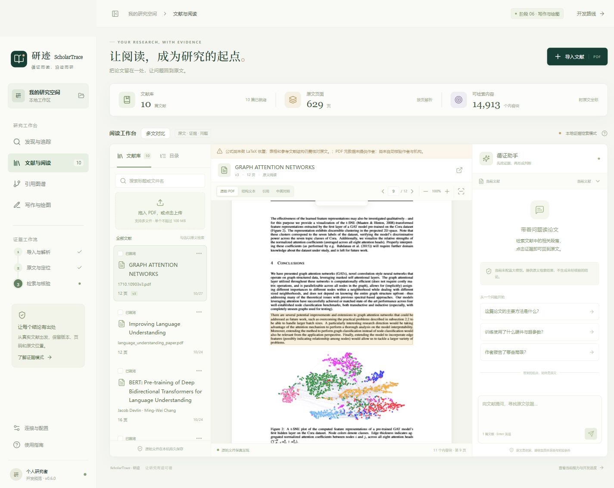
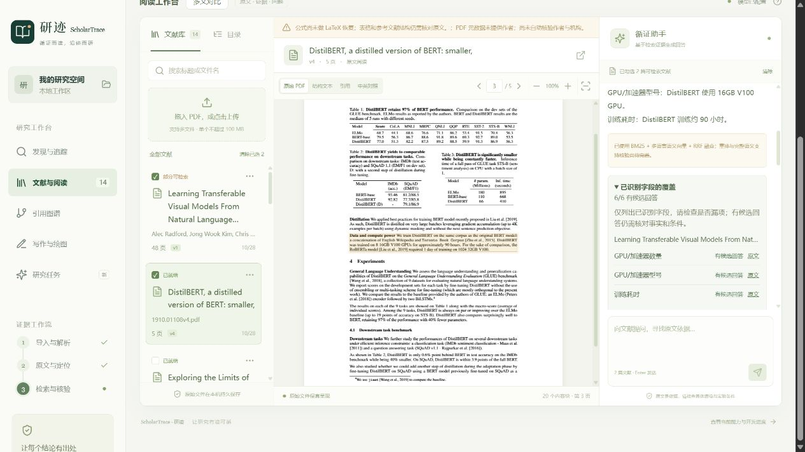
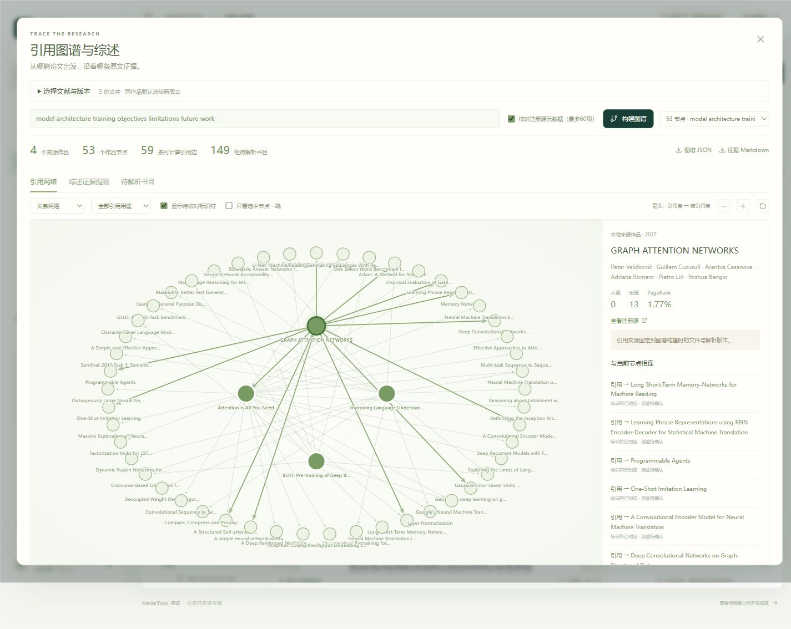
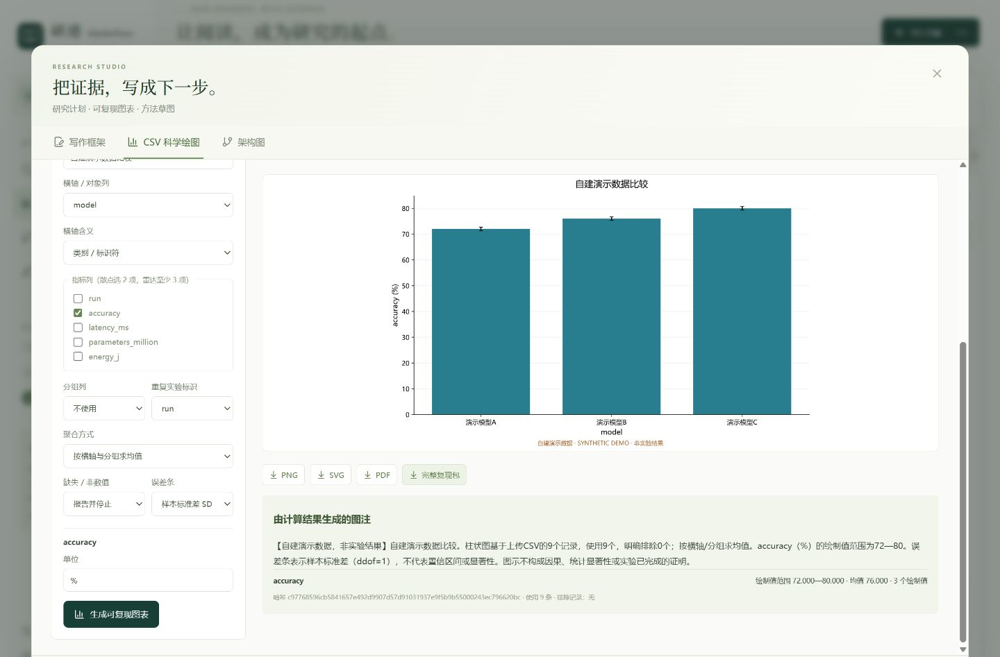

# 研迹 ScholarTrace 技术说明草稿
应用0.9.0；材料阶段12；2026-10-28；参赛身份信息暂不写。

## 作品概述与当前状态
让研究结论回到具体版本的原文

### 科研问题
文献导入、阅读、问答、比较和写作常常各自保存结果，来源版本及生成条件容易丢失。研迹用文件哈希、解析快照和原文坐标连接这些操作，并保存研究任务的步骤、预算及实际产物。

### 当前成果
应用0.9.0为React/TypeScript前端、FastAPI后端和SQLite持久化的本地单用户开发版。已有六模块操作路径，并新增逐文逐字段补检索、覆盖状态与原文跳转。模型服务不可用时明确返回证据候选。

### 本稿用途
本文更新至产品提交b65058f；材料阶段12补充离线人工复核工具。封面按用户意见暂不填写身份信息。公网部署、视频成片、独立人工质量复核和完整公式恢复仍未完成，本文不是正式验收通过证明。

> 可检查的位置、可保留的缺失、可恢复的过程。

## 需求分析与六模块覆盖
区分操作路径、事实质量与交付要求

| 赛题模块 | 现有实现 | 待完善边界 |
|---|---|---|
| PDF管理与解析 | 批量上传、版本提示、OCR、目录及坐标 | 语义去重基线；复杂表格及LaTeX恢复 |
| 抗幻觉问答 | 混合检索、逐文逐字段补查、原文锚点 | Rerank、语义蕴含、独立质量复核 |
| 联读与翻译 | PDF原页、数字引用往返、原译段落对齐 | 词级悬停、作者年份消歧、译文重排 |
| 发现与推荐 | arXiv/Crossref、版本确认入库、主题反馈 | 全量追踪、引用价值与多用户推荐评测 |
| 图谱与综述 | 书目边、局部指标、综述证据提纲 | 语义综述及旧idea解决程度判断 |
| 写作与绘图 | 来源框架、CSV六类图、受控架构图 | 自主学术写作、自由分析与因果判断 |

### 交付约束
按用户提供赛题文字整理：源码与真实Git历史、README及环境说明；5-8分钟、至少1080p的普通话MP4；不超过30页技术PDF；公网演示和必要评审账号。身份信息正式提交前仍需按报名要求补齐。

### 验收原则
接口与界面可操作不等于模型事实正确。自动检查、原文定位、人工标准事实与回答裁决分别记录，不能用有效引用ID替代语义质量结论。

## 系统架构与技术选型
共享证据底座，服务端约束工具执行

### 交互与接口
React/TypeScript组织阅读、比较、图谱、写作和任务工作台；PDF.js显示原始页面并按坐标高亮。FastAPI以显式请求Schema提供接口，后台处理解析、索引和研究任务，前端轮询进度。

### 本地计算选择
PyMuPDF提供原生文字及坐标，RapidOCR补充扫描页；BM25与多语言MiniLM以RRF融合。轻量模型便于无GPU本机运行，但尚无与更强Embedding/Rerank的公平质量对照。SQLite支持单机事务与任务检查点。

### 模型集成
后端适配Chat Completions兼容服务，使用JSON对象、固定来源和1600 token输出预留。本机接入DeepSeek compatible / deepseek-flash，仅证明实际闭环；没有多服务商优劣结论。密钥只保存在本机环境配置。

## 数据模型与版本证据链
重新解析后，历史回答继续指向旧快照

| 实体 | 实际职责 | 约束 |
|---|---|---|
| Work / Version | 作品身份和论文版本提示 | 内容重合和标识符辅助，证据不足不覆盖 |
| Document / SHA256 | 实际PDF资产与字节去重 | 哈希相同不等于所有作品身份已消歧 |
| ParseRun / Block | 解析历史、原文、页码与坐标 | 重新解析新增快照，历史引用不漂移 |
| Evidence / Claim | 候选来源及带引用的陈述 | 来源检查不等于语义支持 |
| Task / Artifact | 工具步骤、预算和产物 | 恢复复用已完成步骤，记录失败与缺失 |

### 版本生命周期
官方Transformer v1/v7按内容重合及元数据提示版本，不仅依赖文件名。用户可选择保留；新旧依据不足时不自动覆盖。解析与回答固定实际文献和ParseRun。

### 失效处理
删除来源后，相关陈述移除，字段覆盖标记来源已失效。评测绑定PDF哈希、文本摘要、页码和坐标，发现漂移时停止，而非静默替换标准证据。

## 解析、阅读与上标保真
保留原页，明确候选和局部失败

### 原生与OCR
标准PDF提取内容块、层级目录、引用和结构候选；扫描页保存OCR行坐标、分数与抽取方式。官方15页扫描件完成真实OCR，541页长书完成原生解析。识别分数不是准确率，长书翻译与并发内存仍待验收。

### 数学与表格边界
表格保留行列、表头、空值及单元格坐标，复杂无框和合并表头仍有错误。CLIP第16页矢量路径超过表格提取预算，文献保持partial，正文可用。原生字体上标保存为受原文哈希约束的版式表示；不是完整LaTeX恢复。

### 联读与翻译
数字引用与References支持往返；作者年份消歧未完整实现。翻译提供段落/页/全文任务、术语保护、缓存、重试和原译导出，已有真实单段样本；没有词级悬停和PDF译文重排。

## 字段级问答与跨文补检索
把所问字段、文献归属和回答状态分开核对

### 本地检索
通用检索后，按识别字段与所选文献轮流补查，最多12次本地查询、每次3个命中，最终仍受请求k约束且最多12条证据。关键词提示用于分配候选，不是语义证明；书目区间不作为实验事实正文。

### 生成与检查
固定字段最多8类，模型最多20行，一次生成；仅接收实际document_id、字段和候选来源。服务端检查同篇引用、数字和明显公式残片，区分候选回答、候选不足、未完成、冲突及来源失效。未知表达和复杂否定仍可能漏识别。

### 用户核对
覆盖面板只列已识别字段，每项可回到原文。候选不足不能推断整篇未报告，有候选回答也不等于事实正确。比较工具另按文献和维度保存逐格证据与条件。

## 意图任务、预算与恢复
把工具计划变成可检查的执行轨迹

| 工具 | 实际产物 | 执行边界 |
|---|---|---|
| evidence | 固定版本候选与字段回答 | 本地补查有界，模型调用计入预算 |
| comparison | 逐文逐维事实矩阵 | 维度白名单、条件和缺失状态 |
| graph | 书目网络和局部指标 | 已有书目与缓存注册记录 |
| writing | 来源框架和研究计划 | 不虚构已完成实验 |
| diagram | 步骤架构图和导出 | 受控配置，不执行任意代码 |

### 规划与执行
规则或模型建议工具和维度，服务端校验白名单再执行。预算约束工具次数、模型次数、预留输出及活跃时间。暂停/取消在步骤边界生效，预算耗尽保留部分成果，调整后可以继续。

### 恢复证据与范围
SQLite保存步骤与确定产物ID。第七阶段实际停止并重启服务，首步产物与attempts保持，随后完成5步。当前是自实现受控状态机；角色标签不代表独立自主Agent，未实现完整LangGraph Supervisor或自由重规划。

## 文献发现、追踪与引用图谱
元数据、全文和学术判断具有不同证据要求

### 发现与入库
arXiv/Crossref查询区分精确标识与标题候选，核对作者、年份和来源。确认后从受限官方路径下载确切arXiv版本，保存时间与哈希；其他出版方提供核对入口，不抓取任意链接。

### 追踪与反馈
周期主题检查依赖服务持续运行，只覆盖最近有限窗口；失败不推进成功检查记录。点赞/踩参与共享词排序与隐藏，尚无推荐质量、引用含金量或全网漏检率结论。

### 图谱与洞察
边源于原书目，注册元数据辅助身份核对。历史样例53节点59边，其中49个外部节点多数只有元数据；PageRank只描述所选子图。未来工作给出原文与后续候选，未判定旧idea已解决或新方向具有创新性。

## 写作框架与科学绘图
把来源、变换和重画方式一起导出

### 写作辅助
研究计划区分摘录、待核验事实、分析与计划，保留历史与来源失效状态。导出Markdown、注册BibTeX与证据包；外部书目记录不冒充本地全文，框架不是已完成实证论文。

### CSV到图形
读取编码、类型、缺失、重复与前导零信息，显式选择清洗、聚合、SD/SEM和归一化。六类图形导出PNG/SVG/PDF，附原始/处理数据、配置、计算图注和重画脚本；演示数据明确为自建软件测试素材。

### 能力边界
受控架构图支持Mermaid等导出；不执行模型自由代码。自然语言自由分析、自主实验证明、因果推断和原创性判断尚未实现。

## 评测协议与历史演进
观察后退役为回归，保留首次失败

| 阶段 | 实际范围 | 严格证据组命中 |
|---|---|---|
| 8 / 0.7.0 | 20题；12题当时按作品留出 | 12/23；120/120锚点有效 |
| 9 / 0.8.0 | 上述20题已观察开发回归 | 最终22/23；保留中间退步 |
| 10 / 0.8.0冻结 | DistilBERT/CLIP新8题及2项缺失检查 | 8/10；48/48锚点有效 |
| 11 / 0.9.0 | 全部28题开发回归 | 32/33；168/168锚点有效 |

### 冻结与可复现
题集绑定确切PDF版本、哈希、页码、坐标和文本指纹，请求不包含标准事实。每轮独立保存原响应及代码摘要。最新freeze_stage11_v3含12个文件，以UTF-8/LF规范化避免Git换行造成伪变更；旧字节指纹保留。

### 不能推出的结论
不同阶段的题集、配置和观察状态不同，不能把表中分数当同分布准确率曲线。严格块组并非穷尽等价证据。标准事实为助手草稿，公开论文可能在预训练中；没有盲测或独立人工金标准。

## 最新模型样本与未解决问题
有锚点、有候选，仍然需要完整事实复核

### 阶段11实测
6题各一次真实生成，无错误或降级；36/36锚点有效，20/20保留陈述引用有效，9/9指定证据组命中。21个识别字段有20个候选、1个待核对。p50=3.1005秒、p95=4.5569秒，本机顺序小样本不是并发SLA。

### 已保留失败
N01层数未通过检查；未保存被拒绝原始行，具体拒绝原因不能补造。H01指定摘要块仍漏召回。首轮缺失检查把“不从型号推断”误作型号需求，出现额外型号陈述；通用限制过滤后两项复测均无保留陈述，不解释为拒答准确率100%。

### 费用与质量边界
阶段11显式生成11次，输出预留上限17,600 token，不是账单用量。独立人工复核0/6，完整正确率、已回答准确率和引用语义支持率保持null。本材料阶段离线整理不再次调用模型。

### 人工复核入口
本地离线页面展示已保存问题、回答、标准事实草稿、引用和定位信息。人工填写真实身份、判定、支持条数和依据，导出绑定问题/响应哈希的JSON；离线CLI只核对原运行，不重新问模型。默认全部待复核，不自动给出正确结论。

> 来源位置检查与语义质量裁决是两项不同工作。

## 工程验证、运行与部署
本机验证记录与生产准备分别管理

### 已有验证
产品阶段11全量226项测试通过，含字段归属、上限、快照、删除失效、公式残片和指纹检查；1项既有依赖弃用警告。TypeScript与Vite生产构建通过，桌面1280及390窄屏验收。材料阶段12的工具检查另见STAGE12_TEST_REPORT.md。

### 本机运行
使用Python3.12独立.venv312与requirements.lock.txt；前端按pnpm-lock.yaml安装。复制.env.example并在本机配置模型，scripts/dev.py启动API及前端。OCR与语义模型需显式准备，常规上传和问答不自动下载权重。

### 部署缺口
当前服务仅本地监听，无公网用户认证和文件隔离。生产部署仍需权限、上传及速率限制、服务端密钥、HTTPS、备份、预算和评审账号，尚未提供公网地址或可用性承诺。

### 复现含义
模型服务可能非确定。可复现应保留确切输入、代码、来源快照、配置、原响应和工具轨迹，不承诺每次生成逐字一致。包含原文的离线复核页面仅留本机，不放进公开材料包。

## 工程创新与AI协同
以可检查的问题和边界说明创新

### 证据生命周期
文件、作品版本、ParseRun与引用构成同一条证据链，降低重解析导致历史结论漂移的风险；删除失效与评测指纹使来源变化可见。这是具体工程设计，尚无对照证明全面优于其他系统。

### 字段与流程连接
把跨文问题拆为论文/字段，用有界本地补查、候选状态和原文按钮呈现缺口；同一证据工具进入可预算、可恢复的研究任务。固定字段规则和受控状态机的泛化、自主性仍有明确上限。

### Prompt优化
从保留来源和数字条件，推进到文献/字段结构输出，限制未问精度和公式；检查不信任模型自报成功。观察题退役为开发回归，保留首次失败、修复及全部版本记录，未以重复采样掩盖失败。

### AI贡献与参赛者责任
Codex参与需求拆解、代码与测试草稿、排错、材料和本机执行；用户提供赛题与官方PDF并配置服务。标准事实和文档仍需真实人工复核，不能虚构成员已逐行审核。参赛者需理解架构、核心代码和失败分析，并确认原创性及第三方许可。

## 交付状态与后续计划
当前可审阅，正式提交仍需补齐成果

| 现有材料 | 正式交付前动作 |
|---|---|
| 本地源码、锁定依赖和分阶段Git历史 | 远程评审访问、完整新机安装与最终版本冻结 |
| 更新的技术PDF与7分钟脚本 | 真实1080p MP4、普通话讲解和成片属性核对 |
| 28题回归、真实原响应、离线复核工具 | 人工金标准、语义裁决及其他新作品验收 |
| 本机演示与字段原文跳转 | 鉴权、隔离、公网部署、账号和持续可用性 |

### 后续优先级
先完成真实人工来源/回答复核，再补新作品及等价证据；同步完善公式与复杂表格、完整需求解析和并发测试。产品稳定后准备公网部署与视频，核对文档、仓库、视频和运行版本一致。

### 来源记录
需求依据为用户提供赛题材料；实现及实测见backend/app、docs/STAGE1-12_TEST_REPORT.md与evaluation/results。公开论文确切版本：arXiv 1907.11692v1、1910.10683v4、1910.01108v4、2103.00020v1；官方原文另由用户提供。截图均标注阶段。

### 提交前确认
封面暂不填写身份，README身份信息正式提交时按报名要求补齐。不公开密钥、数据库、论文全集或模型缓存。未向主办方提交；截止日期及最终模板由参赛者在报名系统确认，冻结产物并保留哈希备份。
