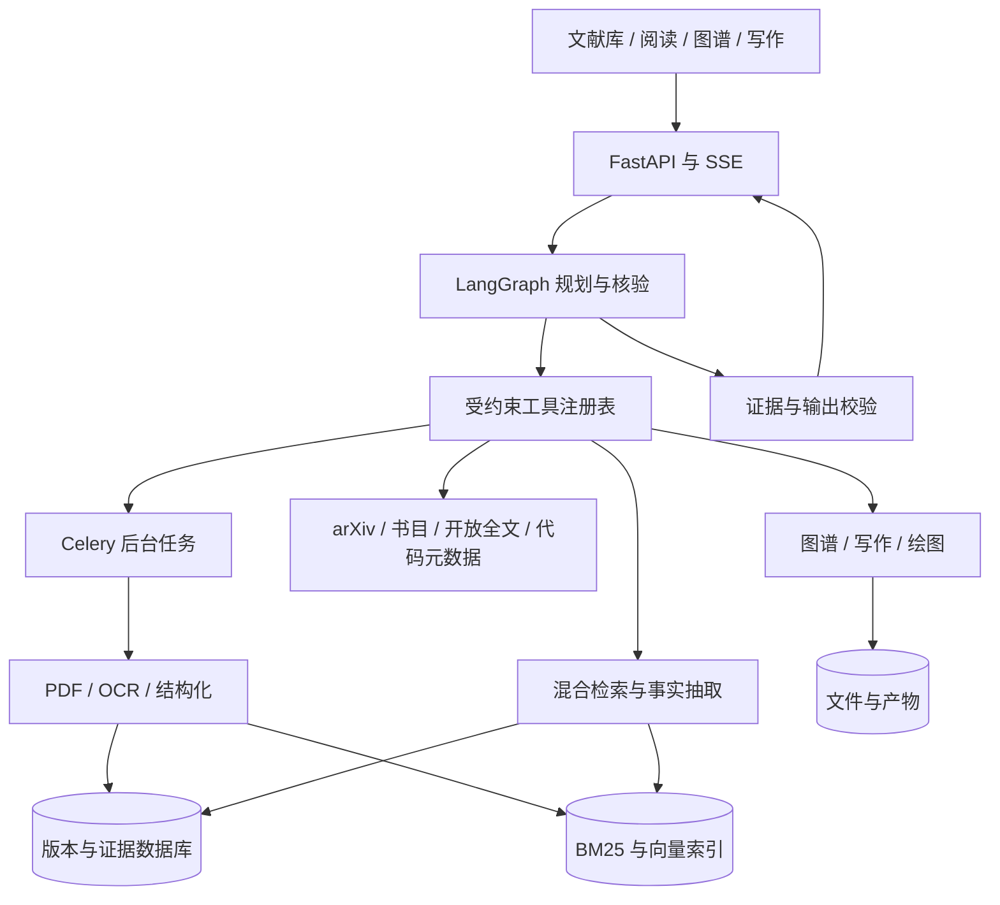

科研助手 Agent 挑战赛详细实施方案

编制日期：2026 年 10 月 24 日。依据：用户提供的赛题全文。本文是待实施的设计与验收方案，不是已经完成的系统或实测报告。

**1．总体判断与执行假设。** 建议做一款“研迹 ScholarTrace：基于版本化证据链的科研助手”，围绕“发现论文—管理版本—理解原文—跨文比较—核查方向—辅助写作与绘图”形成闭环。六个模块都有真实可运行的最小交付，重点打磨证据溯源、版本演进和图谱洞察。技术深度 35% 与科研场景创新 25% 合计 60%，因此开发重心应放在可以验证的智能行为和证据质量上。

按个人参赛、已有 Python 与基本 Web 开发能力、每天投入约 6—8 小时、能够调用一个稳定大模型 API 进行规划；不把从头训练模型列入前置条件。2026 年 10 月 24 日至 11 月 17 日是 25 个开发日，11 月 18 日预留给提交与访问问题。这个周期适合完成比赛规模的产品，通用科研平台还需要持续迭代；若编程基础不足，必须压缩非核心美化、微服务和高级个性化范围。

材料把省赛提交写为 2026 年 11 月 18 日、评审反馈写为 2027 年 1 月底，但国赛报名及提交又安排在 2026 年 12 月，存在时间冲突。国赛二等奖/三等奖比例也有 20%/35% 与 25%/30% 两种表述。以下只按材料中的 11 月 18 日保守倒排，不替主办方确认规则。还需核实“指导提交”和最终提交的关系、个人参赛资格、官方 pdf/ 获取位置、线上服务保持时段及提交后修复规则。

当前工作区未见官方测试 PDF。文中所有准确率、耗时、资源配置和阈值均为开发目标或起始设置，必须在取得实际文件和目标部署环境后测试。

**2．产品形态与演示主线。** 一个研究项目管理一组论文及其版本，用户可以直接提出复杂目标，例如：“比较 Transformer、BERT 和 GPT 系列的结构演进，列出逐项证据，核查其中的未来方向是否已有后续工作，并生成一份带真实引用的综述提纲。”系统把这个目标拆为选文、检索、抽取、比较、核验、生成与导出步骤。

建议页面分成文献库、阅读工作台、研究图谱、写作与绘图四个主要入口。阅读工作台采用左侧目录、中间 PDF/译文、右侧问答与证据卡片；证据点击后回到原文高亮。工具执行状态置于任务面板，显示步骤、工具、耗时、证据数量和失败恢复。用户不需要面对内部数据库、向量索引等实现细节。

| 赛题模块 | 首次提交必须完成的闭环 | 做深后的加分表现 |
|---|---|---|
| PDF 管理与解析 | 单篇/批量上传、列表、删除、元数据修改；扫描件 OCR；标题树、正文、图表、公式识别、参考文献和附录；内容去重；长书任务 | 版本差异定位、表格数值差异、复杂版式泛化 |
| 抗幻觉问答 | 单篇事实与表格数值；逐项证据；缺证据拒答；多篇比较表 | 版本约束、结构化事实核验、自动补检索 |
| 阅读与翻译 | 原始 PDF、目录、正文引用/References 双向跳转；局部和全文翻译；双向滚动 | 跨页段落对齐、术语表、翻译缓存 |
| 检索追踪推荐 | 标题/参考文献检索、身份核验、可获得全文下载入库；周期追踪；推荐理由与赞踩 | 引用用途排序、复现准备度、多样性控制 |
| 图谱与综述 | 20 篇以上引用图谱；局部核心节点；有证据综述；Future Work 后续进展核验 | 引用用途加权、时间线、外部共同祖先展开 |
| 写作与绘图 | Idea 到框架；真实 References；架构图脚本；CSV 到表/折线/柱状/雷达与三维展示；Caption；学术中译英 | BibTeX、图形主题、图表规格校验与复现实验包 |

整篇翻译优先输出对齐 HTML/Markdown，因为赛题允许该形式。原位重排译文 PDF、多用户协同编辑、推荐模型训练和超大图谱可后置。公式识别、长书和原文定位属于核心要求，不能用后置增强代替。

**3．推荐技术栈。** 采用一个前端、一个模块化后端、一个后台任务体系。多 Agent 用角色化工作流实现，不要求每个角色变成独立服务。

| 层 | 主选型 | 使用方式 |
|---|---|---|
| Web 前端 | React + TypeScript + Vite | 单页研究工作台；熟悉 Next.js 或 Vue 的情况下可沿用，不为框架迁移耗时 |
| 阅读与公式 | PDF.js + KaTeX | 原 PDF 保真阅读、文本/引用热点覆盖层、译文公式显示 |
| 图谱与架构图 | Cytoscape.js + Mermaid | 引用网络交互、架构图预览；图谱与架构图职责分开 |
| API | FastAPI + Pydantic | 类型化接口、权限与资源校验、SSE 任务事件 |
| Agent | LangGraph | 状态、条件路由、补检索、持久化检查点 |
| PDF | Docling 主解析；PyMuPDF 辅助 | Docling 处理版面与结构，PyMuPDF 做页面检查、原生文字/坐标和裁剪 |
| OCR/公式 | 主解析器配置一个 OCR 引擎；局部公式识别/VLM | 仅对需要的页面或区域启用，保留原图和识别质量 |
| 数据 | PostgreSQL + Qdrant | 业务关系和证据元数据存前者，检索向量与过滤字段存后者 |
| 稀疏检索 | BM25 | 比赛规模先用工作区内持久化文本重建索引；无需再引入搜索集群 |
| Embedding | BGE-M3 | 中英文语义检索；第一阶段使用 dense 表征即可 |
| Rerank | bge-reranker-v2-m3 | 对融合候选重排；CPU 紧张时减少候选数量或使用同接口服务 |
| 任务 | Celery + Redis | PDF/OCR、翻译、下载、绘图等后台任务；周期任务使用 Celery Beat |
| 图算法/数据 | NetworkX、Pandas、Matplotlib | 图计算、确定性统计、学术图表导出 |
| 文件/部署 | 持久化文件卷 + Docker Compose + 反向代理 | 比赛版先减少组件；之后可换对象存储 |

Docling 官方文档列出了布局、阅读顺序、表格、OCR 等能力，并提供具有层级、坐标与来源信息的统一文档模型。这些能力可用作基础，实际质量仍需用官方 PDF 验证。[Docling 文档](https://docling-project.github.io/docling/)，[文档数据模型](https://docling-project.github.io/docling/concepts/docling_document/)

BGE-M3 与 reranker 的能力及调用方式以发布者模型卡为准；不假定它们对赛题天然最优。[BGE-M3](https://huggingface.co/BAAI/bge-m3)，[bge-reranker-v2-m3](https://huggingface.co/BAAI/bge-reranker-v2-m3)

主 LLM 通过 ProviderAdapter 接入，必须支持可靠的结构化输出与工具调用。用同一组约 30 道问题测试现有可访问 API 的中文指令、多文比较、证据遵从和费用后，锁定一个主模型；复杂分析可升级到第二档模型。模型名称、端点、预算都放环境配置中，不在业务代码内写死。无需照搬赛题列出的较早型号。

**4．系统数据流。** 前端发送目标，API 建任务，Agent 调用工具，后台任务执行重工作，结果入库后以事件回传。PDF、索引、证据、译文和最终产物均有稳定 ID。



API 只接收上传和建任务，不等待 541 页解析结束；返回 job_id。SSE 推送 page_done、retrieval_done、evidence_ready、claim_verified、artifact_ready、error 等事件。断线重连通过事件序号恢复，任务状态仍以持久化存储为准。

**5．先实现统一数据模型。** 同一论文、不同版本、不同文件和不同解析结果必须区分，否则旧问答会引用到新版本的不同位置。

| 实体 | 关键内容 |
|---|---|
| Workspace / User | 项目、用户、角色、评审数据隔离 |
| PaperWork | 学术作品、规范标题、作者、可信 DOI/arXiv 根 ID |
| PaperVersion | v1/v7 等修订、来源、版本日期、默认版本 |
| FileAsset | 具体 PDF、SHA256、存储路径；文字版与扫描版可为同版的不同文件 |
| ParseRun | 解析器/配置版本、开始时间、状态、错误与产物 |
| Page | 文件内 1-based 页序号、印刷页码标签、尺寸、裁剪框、旋转、处理状态 |
| Block | 标题/段落/表格/公式/图片/参考文献类型、层级、顺序、原文、规范化文本、坐标 |
| Chunk | 对应版本与解析结果、关联 Block、检索文本、片段类型 |
| Evidence | 原文摘录、源文件/版本/ParseRun、Block、页面与一个或多个矩形 |
| CitationEdge | 引用者、被引作品、参考文献原条目、正文引用位置、消歧状态 |
| Translation | Block、目标语言、译文、术语表/模型/Prompt 版本 |
| AgentRun / ToolRun | 目标、任务步骤、参数摘要、结果、预算、错误与重试 |
| Claim / Artifact | 事实陈述及证据、最终答案、图表/脚本/综述文件和复现信息 |
| Subscription / Feedback | 查询条件、抓取水位、推荐记录、赞踩与理由 |

统一使用左上角原点的归一化矩形，并保留原页面尺寸、CropBox 和旋转信息。前端经 PDF.js viewport 变换高亮，不能直接把后端 y 坐标当浏览器像素。测试缩放、旋转、裁剪页面和双栏。跨页段落允许对应多个矩形。

Evidence ID 由后端创建。模型只能从给定集合选择，不能自由生成页码或坐标。重解析创建新的 ParseRun，历史 Evidence 保留原解析快照；换默认版本不会改写历史答案。删除文献要同步处理向量/稀疏索引和缓存；已删除源应明确不可用，不要把历史链接悄悄指向其他版本。

**6．模块一：PDF 解析流水线。** 首先以 PyMuPDF 检查每页文字层质量，再走版面解析；对无原生文字或识别质量很差的页启用 OCR。不要仅检查第一页后把全书归为扫描件，也不要把普通 PDF 全部转高分辨率图片。

```text
上传 → 文件校验/哈希 → 每页类型判别 → 页面与版面解析
     → 正文/标题/表格/公式/图片/引用识别
     → 低质量页或区域 OCR/公式补识别
     → 结构校验与 Block 落库 → Chunk → 增量索引
```

正文需要处理双栏顺序、断词换行、页眉页脚和跨页段落。标题树综合字号、编号、布局标签判断，保留一/二/三级标题；附录单独标记。作者与机构保留对应关系和置信状态，缺失时不要根据常识补全。

表格保留表号、标题、行列、合并表头、单位、脚注和原图。用于检索时可序列化为“表号 + 完整表头 + 某行字段 + 表注”，同时保留完整表格以回答数值问题。BLEU、硬件和参数问答特别需要防止列错位。

公式保留裁剪图、坐标、编号、邻近解释和识别出的 LaTeX。PDF 通常不含原始 TeX 源，公式恢复本身有误差；渲染成功也不证明公式正确。先按需启用公式识别，低质量公式展示原图与提示，关键数值回答回原图复核。Docling 有官方公式识别示例，但不能据此宣称任意 PDF 都可完美恢复。[公式识别示例](https://docling-project.github.io/docling/_generated/examples/code_formula_granite_docling/)

参考文献要同时保存原条目与作者、题名、年份、DOI/arXiv ID。正文中的 [11]、[3–5]、作者年份引用映射到条目，优先使用 PDF 已有链接，再补规则和结构识别；不确定匹配保留待核验。

**7．541 页长书的工程实现。** 先建立页面清单，按 5—20 页一批起步处理，根据实测调整；每页/每批落库、记录状态并释放图片。长书专用队列限制并发，常规问答使用独立队列以避免被 OCR 阻塞。失败只重试该批，进程恢复后扫描未完成批次，不重新处理已成功页面。

前端只渲染视口附近页面；原文件支持 HTTP Range 读取，PDF.js Worker、页面清理和缩略图延迟加载一起使用。相关接口能力见 [PDF.js 官方 API](https://mozilla.github.io/pdf.js/api/draft/api.js.html)。

目录和章节摘要用于检索路由，最终证据必须来自正文。任务面板显示“已解析 x/541 页”和“索引已覆盖哪些章节”，不能把前几页可读显示为全书完成。完整验收必须抽查前部、中部、最后章节，做一次任务中断恢复，并记录总耗时、峰值内存、页失败数和重试次数。

**8．内容去重与版本演进。** 分四步处理：第一层 SHA256 判断同一文件；第二层从论文首页/可信元数据提取身份，比较 DOI 或 arXiv 根 ID；第三层用规范化题名、作者、摘要及向量召回候选；第四层用正文指纹和章节/段落对齐确认。标识符不能从 References 中随便抓一个来充当本论文身份。

正文指纹可用规范化 token shingles + MinHash；语义向量用于召回和辅助判断。去掉页眉页脚与排版噪声，降低参考文献对相似度的影响。同领域或同方法论文可能很相似，单一余弦阈值不足以自动合并。阈值应由改名文件、v1/v7、扫描/文字版、标题相似但不同论文、同领域论文等正负样本校准。

系统输出四类：同一文件、同一作品的不同版本、相关但不同作品、关系待确认。v7 已入库而后上传改名的 v1 时，提示同作品且已有较新版本，建议保持 v7 为默认；用户可保留两版或改变默认版本。“覆盖”落实为调整活动版本且保留必要历史，永久删除另行操作。没有可信版本日期时，显示无法确定先后，上传时间和文件修改时间不能代替发表版本顺序。

版本比较先按标题树对齐，再段落匹配与文本差异；表格按行列键比较，数值变化单独列出。LLM 只总结差异工具确实找到的增删改，每项差异可跳到两版原文。默认检索只查活动版本；版本比较任务显式检索两个版本，避免把 v1 和 v7 的实验信息混写。

**9．模块二：混合 RAG 与证据核验。** 正文从约 400—700 tokens、重叠 60—100 tokens 的结构化片段起步，按真实段落边界调整。表格不从任意字符处切断，公式绑定符号解释，参考文献单独索引；长书使用章节—段落两级路由。

```text
识别目标论文/版本与问题类型
 → 拆解需要的事实
 → BM25 + Dense 并行召回
 → RRF 融合 → Rerank
 → 扩展完整段落/表格/邻接解释
 → 构建 Evidence 集合
 → 结构化生成 Claim
 → 校验身份、数字、单位、支持关系
 → 补检索或局部拒答 → 渲染可点击答案
```

初始可设两路各召回 20—30 条，融合后 20 条重排，选 6—12 个证据块；多文问题按每篇论文分别召回，不让某篇相关文献淹没其他论文。参数只作为起点，按测试集调优。BM25 负责型号、符号、参数和数字，Dense 负责同义表述。Qdrant 官方支持多阶段和融合检索，项目也可在业务层组合 BM25 与向量候选。[Qdrant 混合检索](https://qdrant.tech/documentation/search/hybrid-queries/)

生成约束示意：

```json
{
  "claims": [
    {
      "text": "一个可独立核验的事实",
      "evidence_ids": ["ev_123"],
      "kind": "reported_fact",
      "status": "supported"
    }
  ],
  "missing_information": ["原文未检索到的字段"],
  "follow_up_queries": []
}
```

区分四层校验：Schema 和证据 ID 有效；摘录确实来自指定原文；数字/单位/指标/实验条件一致；证据语义上支持 Claim。前三层尽量用程序，第四层用规则与独立核验调用辅助，最终通过人工标注评估。不能把增加一个 LLM 视为零幻觉保证。

当问 β₁/β₂、GPU 型号/数量、BLEU 时，要求抽取具体值、实验阶段、任务、单位和出处，必要时核对原页图像。若缺 GPU 数量，只说明该字段未找到，其余有依据字段仍可回答。给用户的形式是“结论 + 原文短摘录 + 版本/页码/表号 + 点击定位”，不把整块检索内容原样倾倒给用户。

**10．多篇论文的比较方法。** 先确定维度，如结构、训练目标、参数量、上下文长度、LN 位置、数据与硬件；每篇独立抽取，再形成事实矩阵，最后写综合分析。

| 比较项 | 论文 A 的事实 | A 证据 | 论文 B 的事实 | B 证据 | 条件/可比性 |
|---|---|---|---|---|---|
| 参数量 | 原文值或未报告 | 版本与锚点 | 原文值或未报告 | 版本与锚点 | 总参数/激活参数等定义 |
| 上下文 | 原文值 | 原文锚点 | 原文值 | 原文锚点 | 训练长度/推理上限分开 |
| 评价分数 | 原文值 | 表格位置 | 原文值 | 表格位置 | 数据集、测试集和训练条件 |

“论文报告的事实”“由多项证据推导的分析”“待验证假设”分别标记。不要把不同测试集上的 BLEU 直接比较，不要把预训练参数当微调参数，也不要凭模型记忆补全缺失单元格。比较结果的每个数值单元格都有自己的证据。

**11．Agent 如何体现自主规划。** 保留一个 Supervisor 负责意图与任务图，四类执行角色负责文献获取、证据检索、分析核验、写作绘图。它们共享状态与工具，不做无休止角色互聊。简单元数据问题直接走短流程；复杂研究任务才拆解和并行。

Agent 状态包含目标、选定作品与版本、步骤依赖、已完成结果、Evidence、待补字段、重试次数、调用/时间预算、产物及错误。规划器根据工具返回的状态重规划，例如某论文仅有摘要，则尝试获取开放全文；失败则把相应比较项标为证据不足。核验发现实验条件不一致则退回重新抽取，不继续生成误导性结论。

建议工具集：search_papers、resolve_reference、download_open_pdf、parse_document、retrieve_evidence、read_source_blocks、compare_versions、build_citation_graph、check_followup_work、validate_bibliography、render_chart、export_artifact。每个工具有严格输入输出 Schema、权限范围、幂等键、超时、错误码与重试策略。

一个问答可从最多 8 次高层工具调用、最多 2 轮补检索起步；批量解析另设页面预算。接口限流使用退避，参数不合法交给规划器修正，鉴权失败不无效重试，达到预算则返回已完成结果与未完成项。LangGraph 检查点要落持久化存储，不依赖进程内 MemorySaver。[LangGraph 持久化文档](https://docs.langchain.com/oss/python/langgraph/persistence)

短期记忆保存当前目标、文献与未完成步骤；长期记忆保存用户显式偏好、收藏和来源明确的事实，不把未经核验的模型输出当知识。论文更新后与旧版绑定的派生缓存需要失效或保留旧版标记。

过程面板展示规划摘要、工具名、脱敏参数、状态、耗时、证据数和错误恢复。展示可审计的行动，不伪造模型内部思维。流式输出可在事实校验后逐段/逐 Claim 发出；等待检索与核验期间持续推送真实进度，避免把尚未核验的草稿直接标为最终答案。

**12．模块三：阅读、引用跳转和翻译。** 原 PDF 负责忠实排版，结构化结果负责导航与语义交互。标题节点绑定 Block 与坐标，点击跳到原页。正文引用热点关联参考文献条目，点击跳到 References；返回保留原阅读位置，一个参考文献有多处引用时提供位置列表。

划词后显示翻译浮层，保留原文、上下文和复制入口；悬停翻译使用短延迟、取消机制与缓存，避免鼠标经过就连续调用 API。扫描页通过 OCR 文本覆盖层或框选区域触发同一流程。

翻译使用 Block 级 HTML，与原文 Block 一一或一对多映射。公式、代码、引用标记、链接与专有名词先替换为保护占位符，翻译后恢复并检查占位符完整性。术语表统一 attention、encoder 等译法，并允许用户设置。全文翻译按章节排队、缓存并展示进度，不默认将 541 页全书一次提交给模型。

双向滚动的关键是“当前可见 Block + 段内相对位置”定位另一侧，不是页面百分比。中文长度不同，百分比同步必然漂移。需要用户操作侧锁定、程序滚动抑制反向事件、节流和跨页 Block 映射；缩放和栏宽变化后重新计算位置。扫描件需补 OCR 选文层或区域选取功能，不能依赖不存在的原生文本层。

**13．模块四：检索、下载、追踪。** 搜索流程是标识符精确查找—标题候选—作者/年份消歧—元数据卡片—开放全文获取—统一入库。不能把首条搜索结果直接作为目标论文，也不能把书目 API 的元数据误当全文。

优先接 arXiv API 与 Crossref；需要更丰富引用数据时再接 Semantic Scholar，生物医学方向扩展 PubMed。保存来源、请求与抓取时间，API 额度和权限按实际账号确认。官方入口：[arXiv API](https://info.arxiv.org/help/api/user-manual.html)、[Crossref REST API](https://www.crossref.org/documentation/retrieve-metadata/rest-api/)、[Semantic Scholar API](https://api.semanticscholar.org/api-docs/)。

Sickle 是 OAI-PMH 客户端，适用于元数据收割，不会自动完成 PDF 全文下载。小规模关键词订阅可先用 arXiv 查询 API；批量 OAI 接入依据官方说明实现。[arXiv OAI-PMH 说明](https://info.arxiv.org/help/ir.html)

周期任务持久化查询条件、上次成功水位和版本，使用少量时间重叠防漏，再按作品/版本去重。分别记录“没有新结果”“请求失败”“被限流”。只下载可合法访问的全文，失败保留元数据与状态；没有全文的论文不能参与细粒度原文问答。

“引用含金量”落实为引用用途与阅读优先级：方法依赖、数据/实验依赖、核心对比、背景提及、待确认。基于正文上下文给推荐理由与锚点，筛选只改变阅读视图，不删除真实引用边。不能把背景引用直接宣称为无价值或客观识别出应付式引用。

**14．推荐算法。** 比赛版采用内容推荐和显式反馈，不训练复杂协同过滤。兴趣来源为用户研究主题、项目种子、收藏/点赞标题摘要向量；点踩作为弱负反馈。先设相关性门槛，再排序，最后做版本归并和多样性控制。

可使用如下可解释工程初值，各特征先归一化，权重必须调优：

```text
score = 0.55 × 主题相关性
      + 0.20 × 用户显式兴趣相似度
      + 0.15 × 复现准备度
      + 0.10 × 订阅时间窗口内的新近性
```

有代码不能弥补主题不相关。代码信号区分作者明确链接的官方仓库、可验证第三方实现、具备环境/许可/运行入口、已实际跑通特定实验；前三类只能称复现准备度。GitHub stars 不代表实验复现成功。推荐理由由真实字段组成，模型只能组织表述。

冷启动让用户选择主题或提供种子论文；新用户没有足够行为数据时不伪装“高度个性化”。保存赞踩前后的推荐变化，既可演示反馈闭环，也便于评估。多用户推荐拓展优先实现用户数据隔离与独立兴趣向量，协同过滤可留作后续。

**15．模块五：引用图谱。** 图节点对应 PaperWork，v1/v7 不作为两篇不同论文。边 A→B 表示 A 引用 B，每条边绑定 A 的具体版本、参考文献原条目和正文引用位置。默认使用各作品的选中版本构图，避免把所有版本的引用叠加。正文确证边、外部数据库边和语义相关关系应分别显示；不能用向量相似度制造引用事实。

对 20—50 篇论文，NetworkX 计算和 Cytoscape 展示足够。第一版展示入度、PageRank 和时间线；PageRank 基于入链，方向必须一致。[NetworkX PageRank 文档](https://networkx.org/documentation/stable/reference/algorithms/generated/networkx.algorithms.link_analysis.pagerank_alg.pagerank.html)

将 PageRank 和局部入度较高者标为“当前文献集合内的候选基石”，点击显示哪些论文引用它、以何种用途引用。低入度/孤立节点只说明当前集合连接较少，不代表质量低。扩展灰色的库外被引节点，帮助发现被当前采样遗漏的共同祖先。图过于稀疏时按真实结果展示，不能补造边。

引用用途加权可作为增强版本，与无权重 PageRank 做对照；重复引用同一作品应限制权重增长。20 篇局部图不能推断全球重要性；论文修订可能加入后续引用，图也不强制当作严格时间 DAG。

**16．有证据的综述与 Future Work 核查。** 先为每篇论文抽取研究问题、方法、任务/数据、主要结果、局限和时间，再形成主题—时间线提纲，最后逐段生成综述。每个关键论点绑定原文；只有元数据的节点只能支持书目事实，不能支持方法或实验细节。

Future Work 流程：提取原文候选—规范为“问题对象 + 目标 + 条件”—合并语义重复方向—生成同义检索式—查询之后的工作—获取可用证据—判断覆盖关系—输出状态。候选需标注是作者明确提出，还是系统从局限推导。

| 状态 | 输出要求 |
|---|---|
| 有证据已解决 | 后续论文、直接证据、问题条件匹配；保留供审计但默认从推荐方向中隐藏 |
| 部分覆盖 | 已解决部分与仍有限制的条件，以及对应证据 |
| 本次范围内未找到直接解答 | 检索来源、时间范围、日期、关键词与局限 |
| 证据不足 | 全文缺失、工具失败、来源冲突等具体原因 |

题名相似不足以说明已解决；必须比较任务和适用条件。检索未发现也不能证明全球没人研究过。候选方向输出“来源—已有进展—仍可能存在的缺口—最小验证实验—风险”，避免直接宣称首创。

**17．模块六：论文框架和真实引用。** Idea 先变成研究问题与待验证假设，再检索现有工作，形成证据表，生成 Abstract/Introduction/Related Work/方法与实验计划/References。未经实施的实验只能作为计划，不能生成虚构准确率、创新效果和已完成式结论。

References 分两层核验：论文真实存在且题名、作者、年份、标识符相匹配；论文内容确实支持正文相关论点。DOI 能打开只验证身份，不等于引用得当。格式化器从验证后的元数据生成引用和 BibTeX，LLM 不自由拼写 DOI。无 DOI 的真实论文可使用有效 arXiv/出版源，不要因此自动判假。

架构图由模型先输出受约束节点/边结构，再转换 Mermaid 或 Graphviz；首版一种路径稳定工作即可，其他格式用模板扩展。导出源码和 SVG/PNG。TikZ 作为增强时要控制编译资源并禁用 shell escape，不让生成脚本访问宿主环境。

学术中译英保留数字、单位、公式、引用和术语，不添加原文没有的结果或贡献。写作工作台标记“事实”“分析”“计划”，帮助用户审查。

**18．CSV 到学术图表与 Caption。** 先读列名、编码、类型、缺失值、单位、样例和数据粒度；检查横轴、纵轴、分组、重复实验和指标方向。仅当单位或实验语义影响结果且无法可靠推断时，才让用户确认。不要静默插补缺失值或把编号当连续变量。

LLM 生成 ChartSpec，服务器校验字段后用受控模板执行。例如：

```json
{
  "chart_type": "line",
  "x": "epoch",
  "y": "accuracy",
  "group_by": "model",
  "aggregation": "none",
  "missing_value_policy": "report",
  "error_bar": null,
  "caption_language": "zh"
}
```

输出至少覆盖表格、折线、柱状、雷达和赛题要求的三维展示；三维雷达采用明确的分组/第三轴模板，解释归一化、指标方向与 z 轴含义。默认科研比较优先清晰图形，不把不同量纲直接塞入同一半径。赛题“三维雷达图”的最终样式可向官方核实，接口预留相应模板。

均值、极值、变化量与样本数由代码计算，Caption 只组织这些真实统计。没有重复实验和适当假设，不生成误差条、显著性或因果结论。标准差、标准误和置信区间明确标注。

每次产物保存 CSV 哈希、列选择、清洗/变换、ChartSpec、Python 脚本、依赖版本、图形和 Caption，导出 PNG/SVG/PDF。使用字体一致、色盲友好配色、单位完整、合理图例、明确坐标范围，避免隐藏零点误导。

首版通过固定模板执行统计与绘图；若允许模型生成任意代码，必须放独立受限环境，默认断网，无密钥和宿主目录挂载，限制 CPU/内存/时间/输出。AST 检查不能当完整沙箱。Mermaid 和用户上传文档的 HTML 也要约束和净化。

**19．建议项目结构与接口。** 目录按职责拆分，先避免插件化平台与过度微服务。

```text
scholartrace/
  apps/web/                 # 文献库、PDF、译文、图谱、写作
  backend/app/
    api/                   # 接口、认证、SSE
    models/                # 业务实体与Schema
    parsing/               # PDF、OCR、表格公式、锚点
    dedup/                 # 身份消歧、指纹与版本差异
    retrieval/             # BM25、Dense、RRF、重排
    evidence/              # Claim、证据与核验
    agents/                # 状态图、角色、工具注册
    literature/            # 外部检索、下载、追踪、推荐
    graph/                 # 引用关系、图算法、方向核查
    copilot/               # 写作、翻译、图表、导出
    jobs/                  # 异步任务与调度
  prompts/                 # 带版本的Prompt与输出Schema
  evals/                   # 标注、评测、消融、报告
  tests/                   # 核心算法与端到端用例
  scripts/                 # 导入、备份、复现
  docs/                    # 技术文档、演示脚本、来源声明
  deploy/                  # Docker Compose、反向代理
  .env.example
  README.md
```

| 接口 | 作用 |
|---|---|
| POST /documents、GET /documents | 上传建任务、列出文献和处理进度 |
| GET /documents/{id}/structure | 目录、页面、Block、表格和引用 |
| GET /sources/{id} | 鉴权后的原 PDF/证据资源 |
| POST /papers/{id}/versions/compare | 版本对齐、差异任务 |
| POST /agent-runs | 问答、跨文比较或复杂研究任务 |
| GET /jobs/{id}、GET /jobs/{id}/events | 状态、进度和 SSE |
| POST /translations | 局部/全文翻译任务 |
| POST /literature/search、POST /subscriptions | 检索与周期追踪 |
| GET /recommendations、POST /feedback | 推荐与反馈 |
| POST /graphs、POST /future-work/check | 图谱和方向核查 |
| POST /writing/outlines、POST /charts | 框架与图表任务 |
| GET /artifacts/{id} | 下载结果、脚本和复现信息 |

敏感配置至少包含 DATABASE_URL、REDIS_URL、QDRANT_URL、LLM_BASE_URL、LLM_API_KEY、LLM_MODEL、EMBEDDING_MODEL、RERANK_MODEL、FILE_STORAGE_ROOT、各源 API key、任务并发与预算。前端不得打包私钥；日志脱敏。依赖以实际跑通版本锁定。

**20．验收集与评价口径。** 建立约 60 道人工标注问答：35 单篇事实、15 跨文比较、10 不可回答。每题记录作品、版本、问题、可回答性、标准事实、原文 Block/页码和备注。再准备去重正负样本、20 篇引用集合、若干 Future Work 核查案例、CSV 图形样例。开发调优和最终验收留出不同题目；同一作品的不同版本不要随意拆到两边造成泄漏。

| 测试 | 重点过程 | 验收与记录 |
|---|---|---|
| 去重 | v7 后上传改名 v1；反向顺序；相似不同论文 | 同作品不同版本识别、建议和用户选择正确；不误合并 |
| 标准解析 | 双栏标题、表格、公式、引用人工抽查 | 阅读顺序、结构和原文坐标一致 |
| 扫描解析 | 官方 img PDF；检查 β、上下标、数字 | 真实触发 OCR；原图可核；关键低置信项有提示 |
| 长书 | 541 页全量；中断重启；后部问答 | 页计数、恢复、前中后部索引；耗时与内存实测 |
| 单篇问答 | 机构、超参、GPU、分数与完整引用 | 事实正确且证据支持，版本与位置一致 |
| 无答案 | 原文缺失字段、虚构实验 | 拒答/局部缺失说明，不借模型知识补齐 |
| 多文比较 | 多论文结构与数值矩阵 | 每格证据、条件一致、缺失值明确 |
| 阅读 | 目录、引用来回、缩放/旋转 | 定位正确、返回上下文不丢失 |
| 翻译 | 长短段、公式代码、扫描件 | 占位符完整、双向滚动、术语稳定 |
| 检索追踪 | 同名、精确 ID、无全文、重复抓取 | 身份正确、无重复、失败与无结果分开 |
| 推荐 | 固定种子、赞踩、代码来源 | 理由可验证、版本去重、用户隔离 |
| 图谱 | 20+ 篇，人工核验边 | 边有原始引用依据，方向正确，不造边 |
| Future Work | 已解决/部分/未找到/证据不足 | 状态和证据相符，无全球首创断言 |
| 写作 | 所有 References 与相关论点 | 文献真实，支持关系正确，无虚构结果 |
| CSV | 正常、缺失值、小样本、多指标 | 数字/图注正确，脚本可重跑 |
| Agent | 超时、限流、参数错、全文缺失 | 有界重试、调整计划、恢复与失败原因 |
| 部署 | 全新环境和公网评审账号 | README 可复现、权限隔离、服务可用 |

项目自设目标可从：可回答题事实正确率 ≥85%、人工核验引用支持率 ≥95%、无答案识别率 ≥90%、程序生成的源锚点有效率 100% 起步。它们不是官方分数线，也不是已达到的结果。60 题只适合比赛级验证，报告实际分子/分母，不能据小样本概括所有领域。

指标分开计算：可回答题正确率分母为全部可回答题；已作答准确率分母为系统实际作答题；误拒答率单列。引用覆盖率是需要证据的事实中有引用的比例，引用支持率是被引用陈述中证据确实支持的比例，二者不能混淆。检索 Recall@k、解析耗时、问答 p50/p95、峰值内存与任务失败率单独报告。

做两组小而真实的消融：Dense → 加 BM25/RRF → 加 Rerank → 加证据核验，对比同题正确率、引用支持率、拒答和耗时；Future Work 仅提取原文 → 加后续研究核验，对比旧方向误推荐数量。固定语料、版本、模型与检索日期，不预填提高百分比。推荐/引用加权属于扩展实验，时间不足时先完成主消融。

**21．创新点如何成立。** 建议把三项做成能答辩的具体成果：版本感知证据链、逐格溯源的跨文事实矩阵、带时间和检索范围的 Future Work 核验。分别展示旧版覆盖风险如何避免、全局检索遗漏某论文如何发现、旧方向如何因后续证据降级或隐藏。

这些是候选工程与交互创新，不因为使用了 RAG、PageRank 或多 Agent 就成为原创算法。每项都写清问题、方法、对照实验、效果与限制，避免只用功能数量包装创新。

**22．25 天倒排计划。** Agent 工具/状态骨架和公网部署从前两天就建立，后续模块持续接入，不在最后补一个 Agent 标签。

| 日期 | 主要工作 | 必须能检查的成果 |
|---|---|---|
| 10/24 | 需求矩阵、取得官方素材、确定验收 | 用例、PDF 清单与哈希、工作量和范围 |
| 10/25 | 前后端、数据库、队列、工具 Schema、公网空壳 | 浏览器上传→任务→状态回传 |
| 10/26 | 标准 PDF 与坐标、主解析器验证 | 原页与 Block 对照、点击定位 |
| 10/27 | OCR、表格、公式与标题层级 | 扫描件和结构结果、低质量提示 |
| 10/28 | 引用、机构、附录与解析校验 | 完整结构树和引用映射 |
| 10/29 | 内容去重与版本选择 | 改名 v1/v7 仍识别；不同论文不误并 |
| 10/30 | 版本差异、长书批处理与恢复 | 541 页任务全量启动、可恢复进度 |
| 10/31 | BM25、Dense、RRF、重排 | 原文检索与候选对照 |
| 11/1 | 单篇问答、证据与拒答 | 超参/硬件/分数及无答案用例 |
| 11/2 | 多文事实矩阵、核验与补检索 | 逐格引用的真实对比 |
| 11/3 | 阅读目录、正文/References 跳转 | 双向导航和返回原位 |
| 11/4 | 局部/全文翻译与滚动 | HTML 译文、公式代码保护、双向同步 |
| 11/5 | 标题/参考文献搜索、身份核验与下载 | 一篇新论文真实入库 |
| 11/6 | 周期追踪、推荐理由与赞踩 | 增量记录、重复抓取幂等、反馈变化 |
| 11/7 | 20+ 篇引用图与核心节点 | 每边可回溯、PageRank/入度解释 |
| 11/8 | 综述与 Future Work 核查 | 带引用综述、后续证据和状态 |
| 11/9 | Idea 框架、书目验证、学术中译英 | References 校验与计划/结果区分 |
| 11/10 | CSV、图注、架构图和脚本导出 | 规定图形可生成、脚本重跑 |
| 11/11 | 六模块全链路与 Agent 重规划 | 一个复杂意图完整执行 |
| 11/12 | 接口失败、预算、缓存与中断恢复 | 失败用例与恢复记录 |
| 11/13 | 问答评测、消融、长书/并发压测 | 真实结果表和限制 |
| 11/14 | 新环境部署、UI、权限和线上可用性 | 公网账号、冷启动和安装核验 |
| 11/15 | 功能冻结、版本候选、文档与测试报告 | 发布标签候选、完整材料初稿 |
| 11/16 | 录制视频、导出技术 PDF | 5—8 分钟 MP4、≤30 页 PDF |
| 11/17 | 干净安装复核、材料对应、提前提交 | 仓库/视频/PDF/线上版本一致 |
| 11/18 | 提交缓冲 | 处理官网、文件和链接问题 |

如果 11 月 2 日前不能稳定完成“扫描件→证据问答”，立即压缩主题样式、原位译文 PDF、协同过滤、多格式架构图等增强；保住六模块基本闭环。11 月 11 日后以修复和验证为主，不再增加大功能。

**23．部署、资源与费用。** 建议目标部署环境从 8 vCPU、16—32GB 内存、足够原始文件及产物空间起测；它是压测起点，不能视为全部模型并行运行的保证。API 承担 LLM 推理，OCR/Embedding/Rerank 可本地或同接口服务；无 GPU 时限并发、降低批次，必要时将解析 Worker 移到独立机器。不要只在开发者电脑跑通就认为公网环境可用。

Docker Compose 中部署 web、api、worker、scheduler、postgres、redis、qdrant 和反向代理；scheduler 单实例，防止同一订阅重复运行。区分开发与评审配置，持久化数据库、原文件、解析与产物，验证备份恢复和健康检查。评审账号使用隔离工作区或可重置演示数据。

成本按实际供应商单价估算：总费用 = 输入 token × 输入单价 + 输出 token × 输出单价 + OCR/Embedding/Rerank + 主机/存储/流量。例：1,000 次问答，每次 8,000 输入与 1,000 输出 token，对应约 800 万输入、100 万输出 token；这只是容量示例，不是计价结论。整书翻译、自动连续下载和大图谱分析单独预算。

以文件哈希缓存解析，以 Block+语言+Prompt/模型版本缓存译文，以问题+语料版本缓存答案；文本变更后失效。设置账号配额、最大上传页数/体积、LLM token 与循环预算，避免测试账号耗尽额度。提交材料前按选定服务的实际报价填写成本表，不引用过时价格。

学术可靠性相关防护包括：论文文字和外部网页属于数据，不能覆盖工具权限；下载校验来源和地址，防止访问内部网络；文件名和路径由服务端生成；脚本执行限制与 API 服务隔离；HTML/图形净化；密钥只在服务端。第三方代码、模型权重、PDF 数据的许可分别登记；获准使用的官方测试数据也不自动意味着可以把教材原文件公开到仓库。

**24．7 分钟演示脚本。** 主线使用同一个研究项目，减少切换。长书预处理可接受，但必须标注预处理、展示真实日志，同时用一个小新文件演示真实输入。

| 时间 | 演示 | 证明什么 |
|---|---|---|
| 0:00—0:20 | 科研问题与项目入口 | 产品定位和闭环 |
| 0:20—1:15 | v7 后上传改名 v1；扫描页；长书完成记录 | 内容去重、解析和长文鲁棒性 |
| 1:15—2:30 | 精准问答点原文、缺失问题拒答、多文表 | 抗幻觉与逐格证据 |
| 2:30—3:15 | 目录、引用来回、翻译与两侧滚动 | 阅读体验 |
| 3:15—4:00 | 真实检索入库、追踪记录、代码推荐与赞踩 | 工具调用与反馈闭环 |
| 4:00—5:05 | 20+ 图谱、候选基石、综述、旧方向核查 | 图算法与学术洞察 |
| 5:05—6:15 | 论文框架和 References；CSV 图、图注、脚本 | 写作与复现产物 |
| 6:15—7:00 | 计划/工具轨迹、一次失败恢复、实测与部署 | Agent 技术深度和完整交付 |

1080p 或更高、MP4、普通话，字幕可选。避免把预处理剪辑成即时完成，不把缓存输出伪装成每次现场推理。现场准备一个可替换的新问题，证明不是固定问答演示。

**25．不超过 30 页的技术文档。** 以 28 页为目标，为排版溢出留 2 页。包括封面 1、概述 1、需求与评分映射 2、架构/数据模型 3、解析/版本/锚点 4、Agent/工具/恢复 3、RAG/多文/核验 4、阅读翻译 1、检索推荐 1、图谱/Future Work 2、写作绘图 1、测试消融 2、部署成本 1、创新限制与 AI 协同 1、参考文献 1。

技术文档必须说明为什么选这些组件、输入输出如何衔接、最棘手失败如何处理、有哪些实测证据。Prompt 审计保存版本、目的、输出 Schema、变更理由、测试结果；AI 辅助编程贡献如实说明。图表和截图应支持论证，避免堆满全部页面。

**26．提交前检查。** GitHub/Gitee 公开或具有评审访问权限；Git 历史真实；README 写清项目、架构、参赛者信息、安装、配置、操作、数据获取与限制。环境变量模板和依赖锁文件完整，所有 key 已移出仓库及历史。固定提交对应发布标签、模型配置、Prompt、测试语料/评测版本；远程模型不保证逐字输出相同，可复现应落实为输入、配置、工具轨迹和产物来源可检查。

核对 5—8 分钟/1080p MP4、≤30 页 PDF、公网地址、评审账号、所需 API 配置、额度和服务有效期。新机器按 README 验证，在线账号真实操作；文档、视频、仓库和部署保持同一版本。保存源代码、视频、PDF、配置与数据库备份。正式提交后的修改按官方规则处理，不自行假设可以静默更新线上行为。

**27．第一天具体动作。** 先取官方 PDF 并记录文件名/哈希；建立需求—功能—用例—产物映射；挑选一个矢量 PDF 和扫描 PDF 做解析基准；锁定 PaperWork/Version/Asset/Block/Evidence Schema；让上传任务跑通；标注第一批 10 个细粒度问题和 5 个无答案问题；用这些样本选择解析器、模型和证据格式。优先证明“真实问题→真实原文→可点击答案”这条最短链路，再沿同一证据底座扩展六模块。
